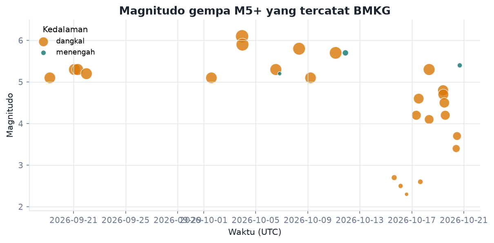
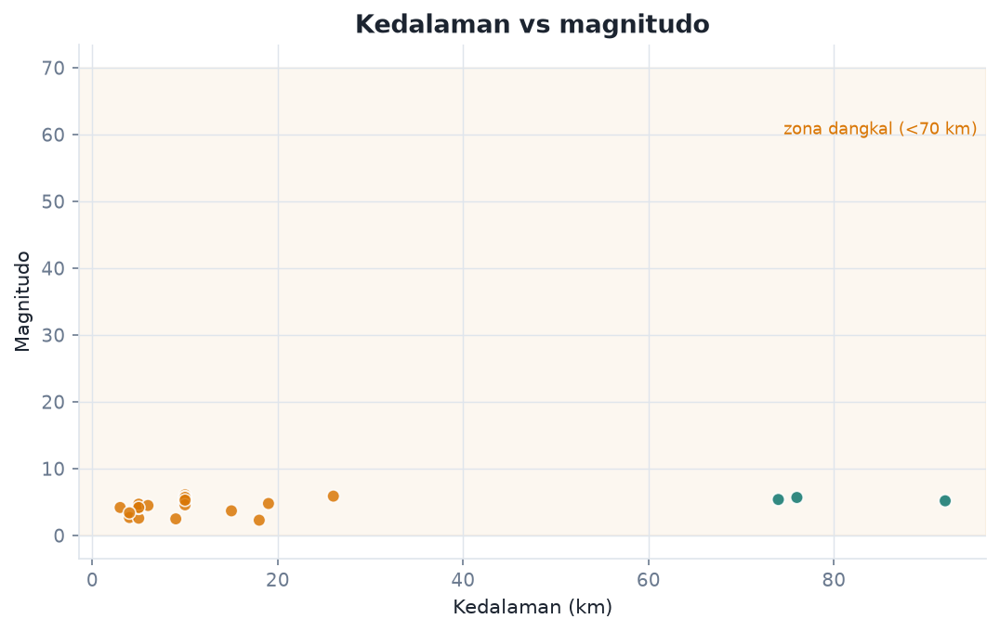
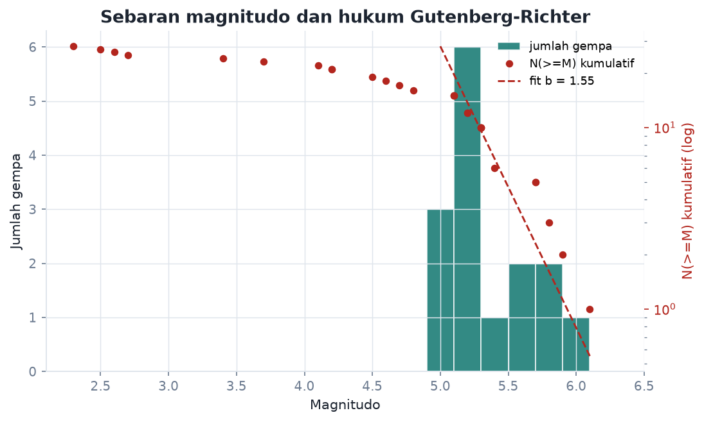
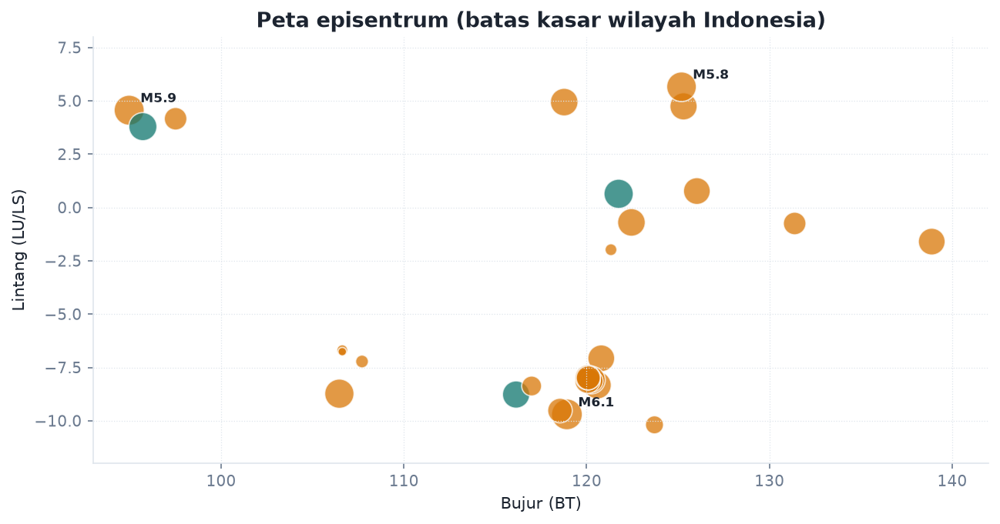

# Laporan Gempa Indonesia

Data terbuka BMKG, diambil 2026-10-20 18:40 UTC. Semua angka di bawah dihasilkan pipeline,
tidak ada nilai yang ditulis manual.

**Data diambil:** 2026-10-20 18:40 UTC  
**Gempa dalam katalog:** 28 kejadian (15 dari katalog M5+, 13 dirasakan)  
**Magnitudo:** rata-rata 4,64, terbesar M6,1  
**Kedalaman median:** 10,0 km (89,3% gempa dangkal)  
**b-value Gutenberg-Richter:** 1,55 +- 0,49 (indikatif, sampel kecil)  
**Total energi seismik:** 0,26 PJ (setara 62.137 ton TNT)  
**Berpotensi tsunami:** 0 kejadian

## Rentang data

| Metrik | Nilai |
|---|---|
| Periode awal | 2026-09-19T04:18:36+00:00 |
| Periode akhir | 2026-10-20T16:29:35+00:00 |
| Magnitudo rata-rata | 4,64 |
| Magnitudo median | 5,10 |
| Kedalaman median | 10,0 km |
| Kedalaman maksimum | 92 km |
| Provinsi tidak terdeteksi | 12 gempa |

## Gempa terbesar

| Waktu (UTC) | Magnitudo | Kedalaman (km) | Provinsi | Wilayah BMKG |
|---|---|---|---|---|
| 03/10 22:55 | M6,1 | 10 | Nusa Tenggara Timur | 14 km BaratDaya KODI-SUMBABARATDAYA-NTT |
| 03/10 23:37 | M5,9 | 26 | Aceh | 68 km BaratDaya CALANG-ACEHJAYA |
| 08/10 08:07 | M5,8 | 10 | Sulawesi Utara | 230 km BaratLaut TAHUNA-KEP.SANGIHE-SULUT |
| 11/10 03:30 | M5,7 | 10 | Jawa Barat | 193 km BaratDaya KAB-SUKABUMI-JABAR |
| 11/10 21:34 | M5,7 | 76 | Gorontalo | 29 km BaratLaut POHUWATO-GORONTALO |
| 20/10 16:29 | M5,4 | 74 | Aceh | 59 km BaratDaya MEULABOH-ACEHBARAT |
| 06/10 13:11 | M5,3 | 10 | Kalimantan Utara | 219 km TimurLaut TARAKAN-KALTARA |
| 21/09 01:41 | M5,3 | 10 | Nusa Tenggara Timur | 34 km TimurLaut RUTENG-MANGGARAI-NTT |
| 21/09 07:31 | M5,3 | 10 | Sulawesi Tengah | 26 km BaratDaya PULAUPUAH-SULTENG |
| 18/10 08:00 | M5,3 | 10 | Nusa Tenggara Timur | 60 km TimurLaut LABUANBAJO-NTT |
| 06/10 20:15 | M5,2 | 92 | Nusa Tenggara Barat | 9 km Tenggara LOMBOKBARAT-NTB |
| 21/09 23:48 | M5,2 | 10 | Sulawesi Utara | 127 km BaratLaut TAHUNA-KEP.SANGIHE-SULUT |

## Provinsi dengan gempa terbanyak

| Provinsi | Jumlah |
|---|---|
| Nusa Tenggara Timur | 3 |
| Sulawesi Utara | 3 |
| Aceh | 3 |
| Papua | 1 |
| Sulawesi Tengah | 1 |
| Sulawesi Selatan | 1 |

## Sebaran magnitudo

| Magnitudo | Jumlah |
|---|---|
| M2.3 | 1 |
| M2.5 | 1 |
| M2.6 | 1 |
| M2.7 | 1 |
| M3.4 | 1 |
| M3.7 | 1 |
| M4.1 | 1 |
| M4.2 | 2 |
| M4.5 | 1 |
| M4.6 | 1 |
| M4.7 | 1 |
| M4.8 | 1 |
| M5.1 | 3 |
| M5.2 | 2 |
| M5.3 | 4 |
| M5.4 | 1 |
| M5.7 | 2 |
| M5.8 | 1 |
| M5.9 | 1 |
| M6.1 | 1 |

## Sebaran kedalaman

| Kategori | Jumlah |
|---|---|
| dangkal | 25 |
| menengah | 3 |

## Jeda antar gempa

| Metrik | Nilai |
|---|---|
| Median | 16,2 jam |
| Rata-rata | 28,0 jam |
| Terpendek | 0,0 jam |
| Terpanjang | 230,5 jam |

## Catatan analisis

- Gempa terbesar M6,1 di 14 km BaratDaya KODI-SUMBABARATDAYA-NTT (Nusa Tenggara Timur), kedalaman 10 km.
- 89,3% gempa di katalog ini dangkal (<70 km). Gempa dangkal terasa lebih kuat di permukaan pada magnitudo yang sama.
- Satu gempa terbesar menyumbang 34,3% dari total energi lepas (0,26 PJ). Energi seismik didominasi sedikit kejadian besar, bukan banyaknya gempa kecil.
- b-value 1,55 +- 0,49 hanya dihitung dari 10 gempa. Dengan galat baku sebesar itu, angka ini belum layak dipakai untuk klaim tingkat seismisitas.
- Korelasi kedalaman dan magnitudo 0,30 (positif). Pada katalog sesingkat ini, magnitudo praktis tidak bisa ditebak dari kedalaman.
- Tidak ada gempa yang ditandai berpotensi tsunami di katalog ini.

## Gambar

*01 timeline magnitudo*

*02 kedalaman vs magnitudo*

*03 distribusi magnitudo*

*04 peta episentrum*

## Keterbatasan

- Katalog publik BMKG hanya memuat gempa M5,0 ke atas dan gempa yang dirasakan, bukan
  katalog lengkap. Semua statistik mewarisi batas itu, termasuk b-value.
- Provinsi ditebak dari teks bebas BMKG. Kalau formatnya tidak lazim, gempa masuk kategori
  "Tidak diketahui" dan tetap bisa diperiksa lewat kolom `wilayah`.
- Data diambil sekali per eksekusi. Untuk kejadian terkini, sumber resminya tetap BMKG.
